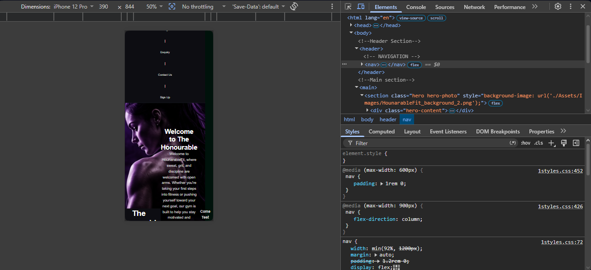
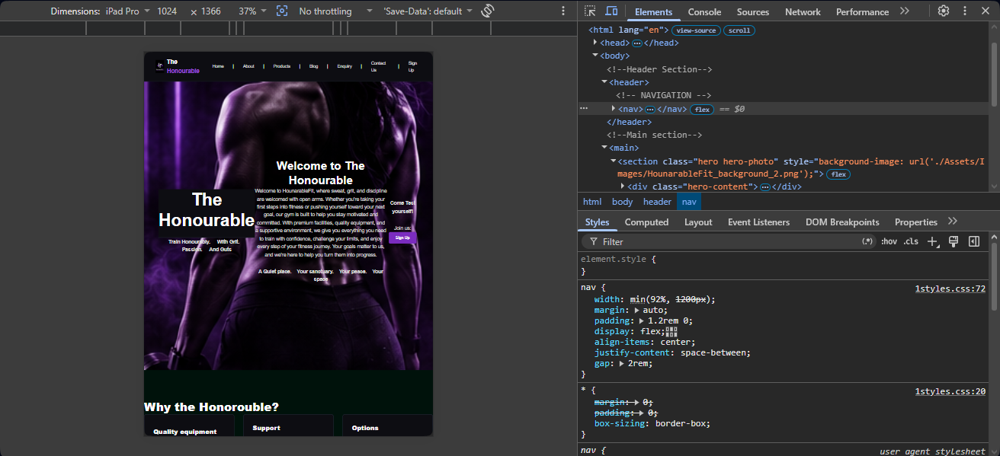
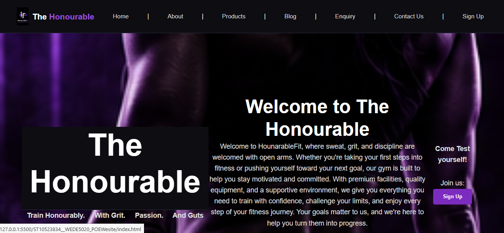
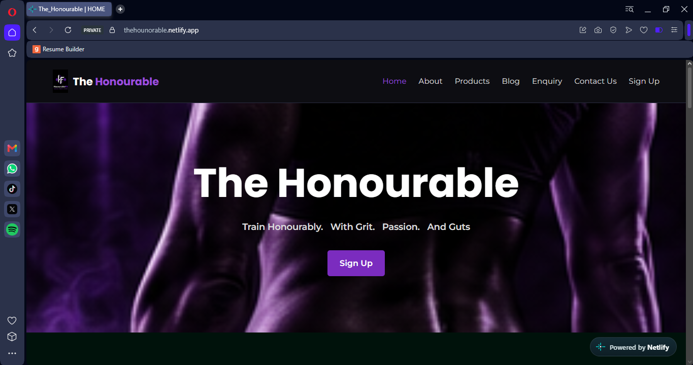
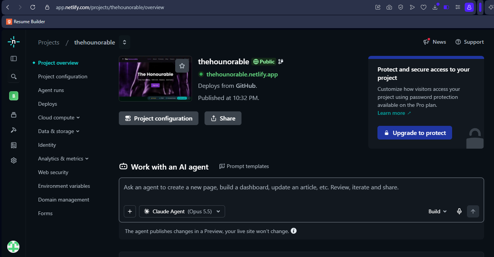
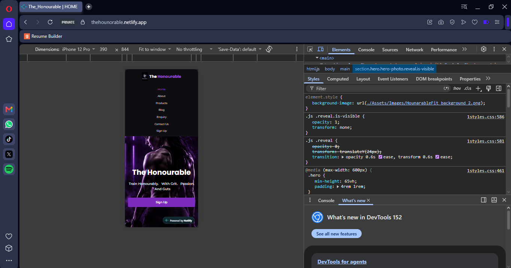

#The Honourable Website
**Student number:** St10523834
**name:** Buhle Qotoyi
---
##Project Overview

Create a website that meets the needs of a chosen target audience.

**Website Goals:*** The website should be able to captivate people’s attention the moment they open it up. It should bring this form of simplicity that makes it easy to navigate through the website. 
Features:•	Homepage
•	About page
•	Contact page
•	Product page (clothing, Supplements)
•	Blog page (for fitness tips)
•	Sign up page
### Part 2 – Styling and branding
---

## Design System

**Colours** (defined once in `:root` at the top of `styles.css`)
**Fonts:** Poppins (headings) and Montserrat (body), loaded from Google Fonts, with Arial as the fallback.
**Responsive breakpoints:** 900px (tablet), 600px (mobile), 400px (small phones).
**Test and Iterate**
## Phone

## Tablet

## Laptop


---

## JavaScript Implementation - Part 3
All of my JavaScript is in one file "Assets/JS/main.js". It has "<script src="…/main.js" defer></script>" just before "</body>" on every page.

### How the HTML,CSS and JS fit
The Js uses hooks in the html like ids, classes and data- attributes with matching CSS for the things it creates.

### Features
1. opening hours plus an "open now" badge
2. Scroll animation
3. FAQ accordion
4. Gallery lightbox
5. Interactive map
6. Blog search, filter and sort function
7. Form validation and submission

   ## Project structure
```
ST10523834__WEDE5020_POEWesite/
├── index.html
├── README.md
├── Pages/
│   ├── about.html
│   ├── blog.html
│   ├── contactus.html
│   ├── enquiry.html
│   ├── product.html
│   └── signup.html
├── Assets/
│   ├── CSS/1styles.css
│   ├── JS/main.js
│   └── Images/
└── Miscellaneous/
```
## How to Run

1. Open the project folder in Visual Studio Code.
2. Right-click `index.html` and choose **Open with Live Server** (or open the file directly in a browser).
3. For the map to appear, an internet connection is needed (Leaflet loads from a CDN).
4. After changing the CSS or JS, hard-refresh with **Ctrl + F5** so the browser does not use a cached copy.

To check for problems, press **F12** in the browser and open the **Console** tab. Any red messages show which script or file has an error.

## Live deployment



## Mobile responsive design


## References
Virgin Active South Africa. (2026). Virgin Active South Africa: Gyms near me. Available at: https://www.virginactive.co.za (Accessed: 5 August 2026)
USN. (2026). USN South Africa online store. Available at: https://za.usn.global/?gad_source=1&gad_campaignid=15838661437&gclid=CjwKCAjwvsvTBhBaEiwAmf-3noOTvTcZoWZmrqQR5fPHuwhbEQ2agsZDmdP-hB-kqR6-67o5vSXhRhoCTr4QAvD_BwE (Accessed: 5 August 2026).
Gymshark. (2026). Gymshark official store: Workout clothes and gym wear. Available at: https://www.gymshark.com/ (Accessed: 5 August 2026)
New perspective Design. (n.d.). What is the cost of creating a website in south Africa? Available at: https://www.newperspectivestudio.co.za/wp/what-is-the-cost-of-creating-a-website-in-south-africa/ (Accessed: 5 August 2026).
Leaflet. (2023). Leaflet: an open-source JavaScript library for mobile-friendly interactive maps (Version 1.9.4). Available at: https://leafletjs.com (Accessed: 2 November 2026).


